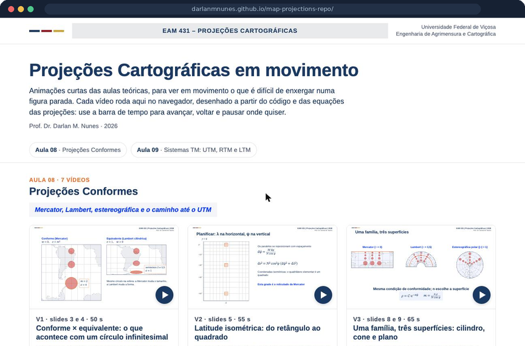
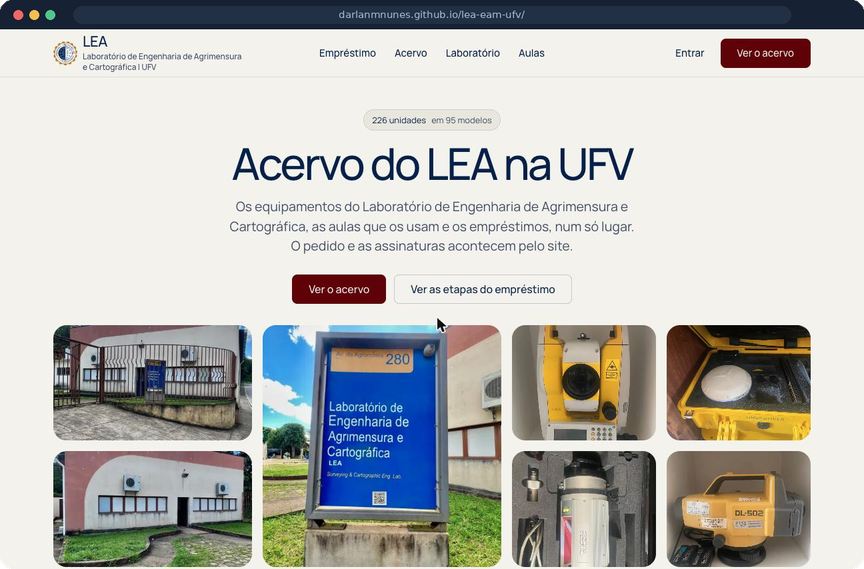
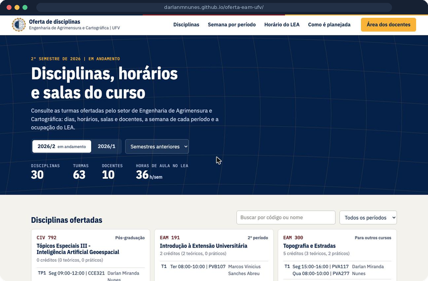

  

  
  
  
  
  

  

### 🗺️ Sobre mim

Sou professor do setor de **Engenharia de Agrimensura e Cartográfica da Universidade Federal de Viçosa (UFV)** e doutor em **Ciências Geodésicas pela UFPR (2025)**. Antes da docência, trabalhei sete anos na Coordenação de Cartografia do **IBGE**. Pesquiso **GeoAI**, **ciência de dados geoespaciais**, **cartografia**, **SIG** e **informação geográfica voluntária (VGI/OpenStreetMap)**, sempre com código, dados e resultados abertos e reprodutíveis.

Hoje também desenvolvo aplicações web para o ensino e para a gestão do território: animações de projeções cartográficas, sistemas do laboratório e do curso, e uma plataforma de regularização fundiária para prefeituras.

<b>🇺🇸 English summary</b>

 

I am a professor in **Surveying and Cartographic Engineering at the Federal University of Viçosa (UFV), Brazil**, with a **Ph.D. in Geodetic Sciences (UFPR, 2025)** and seven years of experience at the Cartography Coordination of **IBGE**, Brazil's national mapping agency. My research covers **GeoAI**, **geospatial data science**, **cartography**, **GIS** and **volunteered geographic information (OpenStreetMap)**, always with open code, open data and reproducible results. I also build web tools for teaching and land management.

---

### 🚀 Projetos em destaque · *Featured projects*

<table>
  <tr>
    <td width="50%" valign="top">
      
      <h4>🏘️ Geo-Fundiário</h4>
      Gestão fundiária para prefeituras: cadastro, mapa, memorial, planta e as 10 fases da REURB, do levantamento de campo ao registro. 
      <i>Land regularization (REURB) platform for municipalities.</i>  
      
      
      
    </td>
    <td width="50%" valign="top">
      
      <h4>🌐 Projeções Cartográficas em movimento</h4>
      Animações didáticas da disciplina EAM 431 (UFV), desenhadas a partir das equações das projeções, com geometria exata em Python e JavaScript. 
      <i>Teaching animations for map projections, built from the math.</i>  
      
      
      
    </td>
  </tr>
  <tr>
    <td width="50%" valign="top">
      
      <h4>📐 Acervo do LEA · UFV</h4>
      Equipamentos, aulas práticas e empréstimos com assinatura digital do Laboratório de Engenharia de Agrimensura e Cartográfica. 
      <i>Surveying lab inventory and equipment loan system.</i>  
      
      
      
      
    </td>
    <td width="50%" valign="top">
      
      <h4>🗓️ Oferta de disciplinas · EAM-UFV</h4>
      Disciplinas, horários, salas e carga docente do curso, com a semana de cada período e a ocupação do laboratório. 
      <i>Course offering, timetable and room planner.</i>  
      
      
      
      
    </td>
  </tr>
</table>

---

### 🔬 Pesquisa com código aberto · *Open research*

Código, dados e resultados dos artigos do doutorado, prontos para reproduzir.

| Repositório | Artigo | Publicação |
|---|---|---|
| [**PhD_Thesis_Step1_OSM_Toponyms**](https://github.com/darlanmnunes/PhD_Thesis_Step1_OSM_Toponyms) | *Collaborative toponyms in OpenStreetMap: an open-source framework to investigate the relationship with intrinsic quality parameters* | [CaGIS · 2025](https://doi.org/10.1080/15230406.2025.2566807) |
| [**PhD_Thesis_Step2_OSM_Toponyms**](https://github.com/darlanmnunes/PhD_Thesis_Step2_OSM_Toponyms) | *Is AI-Based Toponym Extraction of Street-Level Imagery a Reliable Approach for Validating OpenStreetMap Toponyms?* | [BCG · 2025](https://doi.org/10.1590/s1982-21702025000100013) |
| [**INDE_UN-GGIM_Themes**](https://github.com/darlanmnunes/INDE_UN-GGIM_Themes) | *Are National Spatial Data Infrastructures Adequate for Achieving the 2030 Agenda? A Case Study of Brazil's NSDI* | [Transactions in GIS · 2025](https://doi.org/10.1111/tgis.70011) |

📚 Lista completa de publicações no <a href="https://orcid.org/0000-0001-5566-7919">ORCID</a>.

---

### 🧰 Ferramentas · *Toolbox*

  

  
  
  
  
  

  

