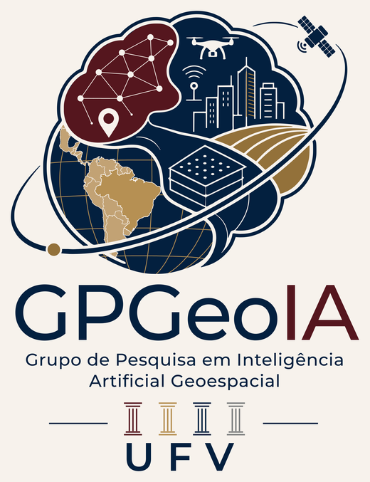

  

  
  
  
  
  
  
  

  

### Sobre mim

Sou Professor Adjunto da Universidade Federal de Viçosa (UFV), com atuação na área de Engenharia de Agrimensura e Cartográfica, e líder do Grupo de Pesquisa em Inteligência Artificial Geoespacial (GPGeoIA/UFV). Desenvolvo pesquisas em Inteligência Artificial Geoespacial (GeoIA), Ciência de Dados Geoespaciais, Cartografia e Mapeamento Colaborativo.

Sou Doutor em Ciências Geodésicas (2025) pela Universidade Federal do Paraná (UFPR), com a tese reconhecida pelo Prêmio UFPR de Excelência Acadêmica como a melhor do PPGCG em 2025. Sou Mestre em Engenharia Civil, área de Informações Espaciais (2016), e Bacharel em Engenharia de Agrimensura e Cartográfica (2014), ambos pela UFV.

Tenho ampla experiência no Instituto Brasileiro de Geografia e Estatística (IBGE), com funções técnicas e de supervisão em produção cartográfica, sensoriamento remoto e fotogrametria, e na docência em Fotogrametria e Sistemas de Informação Geográfica (SIG) na Universidade Federal Rural do Rio de Janeiro (UFRRJ) e na Escola Nacional de Ciências Estatísticas (ENCE/IBGE).

<b>English summary</b>

 

I am an Adjunct Professor at the Federal University of Viçosa (UFV), Brazil, in Surveying and Cartographic Engineering, and the leader of the Geospatial Artificial Intelligence Research Group (GPGeoIA/UFV). My research covers Geospatial Artificial Intelligence (GeoAI), Geospatial Data Science, Cartography and Collaborative Mapping. I hold a Ph.D. in Geodetic Sciences from the Federal University of Paraná (UFPR, 2025), awarded Best Thesis of the program in 2025, an M.Sc. in Civil Engineering (Spatial Information, 2016) and a B.Sc. in Surveying and Cartographic Engineering (2014), both from UFV. Before joining UFV, I worked at IBGE, Brazil's national mapping agency, in cartographic production, remote sensing and photogrammetry, and taught Photogrammetry and GIS at UFRRJ and ENCE/IBGE.

---

### GPGeoIA

<table>
  <tr>
    <td width="30%" align="center" valign="middle">
      
    </td>
    <td width="70%" valign="middle">
      <b>Grupo de Pesquisa em Inteligência Artificial Geoespacial</b> 
      Linha de pesquisa desde 2023 | Certificado no CNPq em 2026 | Setor de Eng. de Agrimensura e Cartográfica | DEC | UFV
        
      O GPGeoIA atua na interface entre Ciência da Informação Geoespacial e Inteligência Artificial. Desenvolvemos e aplicamos métodos, modelos e sistemas de GeoAI para integrar, analisar e interpretar dados geoespaciais multimodais, com foco em mapeamento, inteligência territorial, cidades, agricultura, meio ambiente e apoio à decisão.
        
      <b>Linhas de pesquisa</b> 
      Ciência da Informação Geoespacial e Métodos de GeoIA 
      Visão Computacional, Observação da Terra e Mapeamento Inteligente 
      Sistemas Geoespaciais Inteligentes, GeoAgentes e Geocomputação 
      Inteligência Territorial, Modelagem 3D e Infraestrutura Digital 
      GeoAI Aplicada às Geociências, aos Sistemas Ambientais e Produtivos
        
      <a href="https://gpgeoia.com.br">gpgeoia.com.br</a> | <a href="http://dgp.cnpq.br/dgp/espelhogrupo/1672462604412555">Espelho do grupo no CNPq</a>
    </td>
  </tr>
</table>

---

### Projetos em destaque | *Featured projects*

Em ordem de criação | <i>In order of creation</i>

<table>
  <tr>
    <td width="50%" valign="top">
      
      <h4>Projeções Cartográficas em movimento</h4>
      Simuladores e animações didáticas da disciplina EAM 431 (UFV), desenhados a partir das equações das projeções, com geometria exata em Python e JavaScript. 
      <i>Interactive simulators and teaching animations for map projections, built from the math.</i>  
      
      
      
      
      
      
    </td>
    <td width="50%" valign="top">
      
      <h4>Geo-Fundiário</h4>
      Gestão fundiária para prefeituras: cadastro, mapa, memorial, planta e as 10 fases da REURB, do levantamento de campo ao registro. 
      <i>Land regularization (REURB) platform for municipalities.</i>  
      
      
      
    </td>
  </tr>
  <tr>
    <td width="50%" valign="top">
      
      <h4>Acervo do LEA | UFV</h4>
      Equipamentos, aulas práticas e empréstimos com assinatura digital do Laboratório de Engenharia de Agrimensura e Cartográfica. 
      <i>Surveying lab inventory and equipment loan system.</i>  
      
      
      
      
    </td>
    <td width="50%" valign="top">
      
      <h4>Oferta de disciplinas | EAM-UFV</h4>
      Disciplinas, horários, salas e carga docente do curso, com a semana de cada período e a ocupação do laboratório. 
      <i>Course offering, timetable and room planner.</i>  
      
      
      
      
    </td>
  </tr>
</table>

---

### Pesquisa com código aberto | *Open research*

Código, dados e resultados das etapas do doutorado, prontos para reprodução.

| Repositório | Tema |
|---|---|
| [**PhD_Thesis_Step1_OSM_Toponyms**](https://github.com/darlanmnunes/PhD_Thesis_Step1_OSM_Toponyms) | Topônimos colaborativos no OpenStreetMap e parâmetros intrínsecos de qualidade |
| [**INDE_UN-GGIM_Themes**](https://github.com/darlanmnunes/INDE_UN-GGIM_Themes) | Adequação da INDE brasileira aos temas fundamentais da UN-GGIM e à Agenda 2030 |
| [**PhD_Thesis_Step2_OSM_Toponyms**](https://github.com/darlanmnunes/PhD_Thesis_Step2_OSM_Toponyms) | Extração de topônimos com IA em imagens de nível de rua para validar o OpenStreetMap |

---

### Ferramentas | *Toolbox*

  

  
  
  
  
  

  

